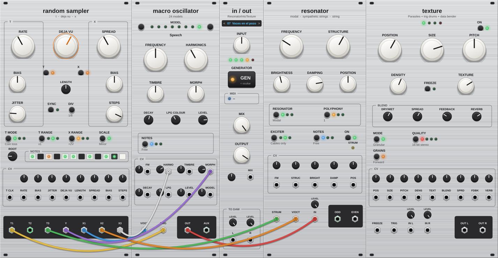

# ResonatorIntoTexture

**A modular tribute to Mutable Instruments** — the celebrated *Rings into Clouds* patch, turned into a patchable VST3
plugin for Linux, Windows and macOS.



ResonatorIntoTexture runs the **original DSP** of Émilie Gillet's Mutable Instruments modules, unmodified and at its
native sample rate, inside five panels you can patch with virtual cables:

| Panel | Based on | |
|---|---|---|
| random sampler | Marbles | random gates and quantized voltages, 42 scales, MIDI-learned scale, host sync |
| macro oscillator | Plaits 1.2 | 24 synthesis models |
| in / out | — | patches, input, generator, mix, output to the DAW |
| resonator | Rings | modal, sympathetic strings, string, FM… with note quantization |
| texture | Clouds + [Parasites](https://github.com/mqtthiqs/parasites) + [mrarm84](https://github.com/mrarm84/customFWCloudsWithDrumMachineAndBender) | granular, stretch, looping delay, spectral, Oliverb, Resonestor, Trig drums, Data bender |

Every control input has its own mini attenuverter, audio inputs have level attenuators, and there are 25 factory
patches plus user presets.

## Manuals

- 📘 [English manual (PDF)](docs/ResonatorIntoTexture-Manual-EN.pdf)
- 📗 [Manual en castellano (PDF)](docs/ResonatorIntoTexture-Manual-ES.pdf)

The manuals cover every parameter, the history of Mutable Instruments and why *Rings into Clouds* became one of the
most beloved techniques in ambient and experimental music.

## Download

Ready-made builds are attached to each [release](../../releases):

| System | File | Install to |
|---|---|---|
| Linux (x86_64, glibc ≥ 2.35) | `ResonatorIntoTexture-linux-x86_64.zip` | `~/.vst3/` |
| Windows (x64) | `ResonatorIntoTexture-windows-x64.zip` | `C:\Program Files\Common Files\VST3\` |
| macOS (Apple Silicon + Intel, ≥ 10.13) | `ResonatorIntoTexture-macos-universal.zip` | `~/Library/Audio/Plug-Ins/VST3/` |

The macOS build is not notarized. If macOS blocks it:

```
xattr -dr com.apple.quarantine ~/Library/Audio/Plug-Ins/VST3/ResonatorIntoTexture.vst3
```

## Building

```
git clone https://github.com/eloyplatas/resonatorintotexture.git
cd resonatorintotexture
git clone https://github.com/juce-framework/JUCE.git external/JUCE
git clone --recurse-submodules https://github.com/pichenettes/eurorack.git external/eurorack
cmake -S . -B build -G Ninja -DCMAKE_BUILD_TYPE=Release
cmake --build build --target ResonatorIntoTexture_VST3
```

- **Linux** dependencies (Debian/Ubuntu): `libx11-dev libxrandr-dev libxinerama-dev libxcursor-dev libxi-dev libfreetype6-dev libfontconfig1-dev libasound2-dev`.
- **Windows**: Visual Studio 2022 with the clang-cl toolset: `cmake -S . -B build -G "Visual Studio 17 2022" -A x64 -T ClangCL`.
- **macOS**: universal binary with `-DCMAKE_OSX_ARCHITECTURES="arm64;x86_64"`.

The GitHub Actions workflow in `.github/workflows/build.yml` builds all three platforms and publishes a release
whenever a `v*` tag is pushed. The exact JUCE and eurorack commits used are pinned there.

## Credits and licences

- **Émilie Gillet / Mutable Instruments** — DSP of Rings, Plaits, Marbles, Clouds and stmlib (MIT).
  Thank you for sharing everything.
- **Matthias Puech** — Parasites firmware for Clouds: Oliverb, Resonestor (MIT).
- **mrarm84** — Trig drums, Data bender and performance effects (MIT).
- **JUCE** — Raw Material Software (AGPLv3).
- **ResonatorIntoTexture** — Eloy Platas. Released under the **GNU AGPLv3** (see `LICENSE.md`), as required by the
  JUCE 8 open-source licence. The third-party DSP in `third_party/` keeps its own MIT licence.

*Mutable Instruments is a registered trademark. This project is not affiliated with or endorsed by Mutable Instruments;
following the wishes stated in the eurorack repository, the panels use functional names instead of the original module
names.*

---

## En castellano

**Un homenaje modular a Mutable Instruments**: el célebre patch *Rings into Clouds* convertido en un plugin VST3 con
cables para Linux, Windows y macOS. Usa el DSP original de los módulos de Émilie Gillet (Marbles, Plaits, Rings y
Clouds con Parasites), con cables, atenuadores, 8 modos de textura, 25 patches y presets de usuario.

Lee el [manual en castellano (PDF)](docs/ResonatorIntoTexture-Manual-ES.pdf) y el [LEEME](LEEME.md). Las versiones
compiladas están en [Releases](../../releases).
